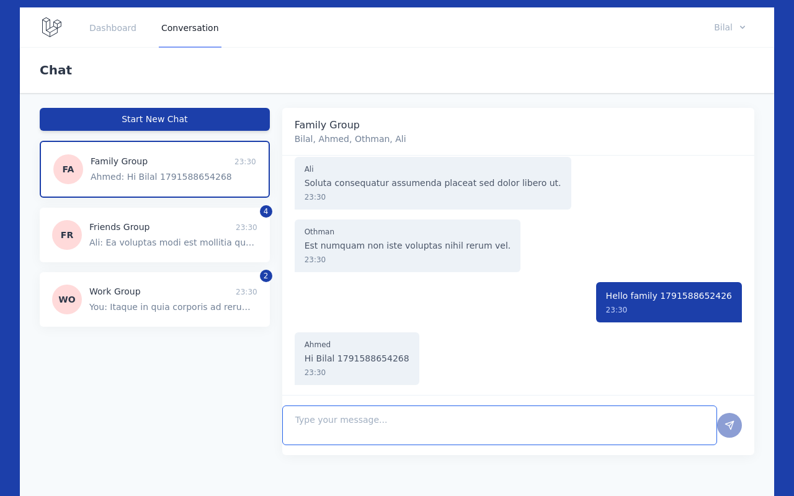
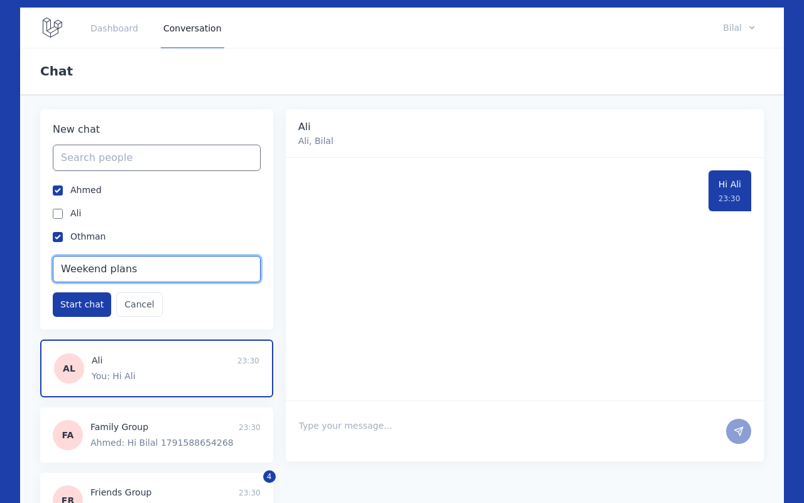
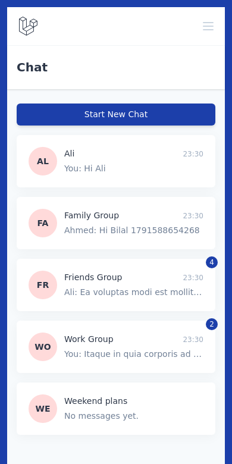

# Chat System

Chat application built with Laravel 10, Inertia.js and Vue 3. People talk one to one or in named groups, and new messages show up without reloading the page.



## Features

- Registration, login, email verification, password reset and profile management
- One-to-one chats: starting a chat with someone you already talk to reopens that conversation
- Group chats with a name
- Unread badges per conversation, cleared when the conversation is opened
- Conversation list ordered by latest activity, with a preview of the last message
- New messages appear on other people's screens within a few seconds (the page asks the server every 5 seconds)
- Only the people in a conversation can read it or write in it
- Works on phones: the list and the open conversation take turns

| Starting a chat | On a phone |
| --- | --- |
|  |  |

## Tech stack

PHP 8.1 to 8.3, Laravel 10, Inertia.js, Vue 3, Tailwind CSS, Vite, MySQL

## Getting started

```bash
git clone https://github.com/belalyasin/chat-system.git
cd chat-system
composer install
npm install
cp .env.example .env      # set the DB_* values
php artisan key:generate
php artisan migrate --seed
npm run dev               # in one terminal
php artisan serve         # in another
```

Seeding creates four demo users and a few group conversations. Their emails and the shared password are in `database/seeders/DatabaseSeeder.php`.

## Tests

```bash
php artisan test
```

The tests run against an in-memory SQLite database and cover authentication, profiles, conversations and messages.

## Routes

| Method | Route | Purpose |
| --- | --- | --- |
| GET | `/conversation` | Chat page with the list of conversations |
| POST | `/conversation` | Start a conversation with `user_ids` and an optional `name` |
| GET | `/conversation/{uuid}` | Open a conversation and mark it as read |
| POST | `/conversation/{uuid}/messages` | Send a message (`body`) |

## Not built yet

- File and image attachments (the `attachment` column exists but is not used)
- Push updates over WebSockets instead of asking the server every few seconds
